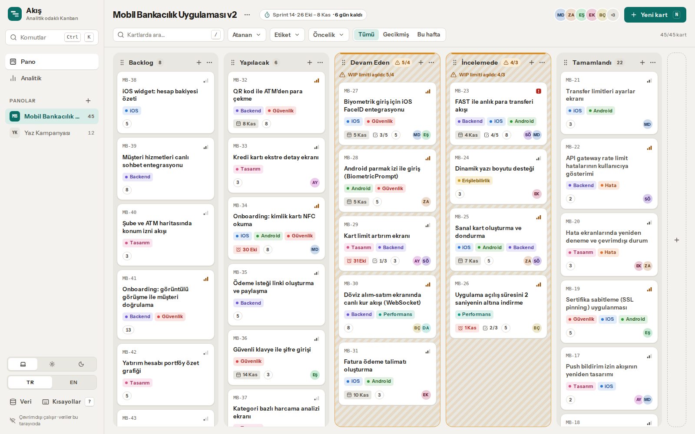
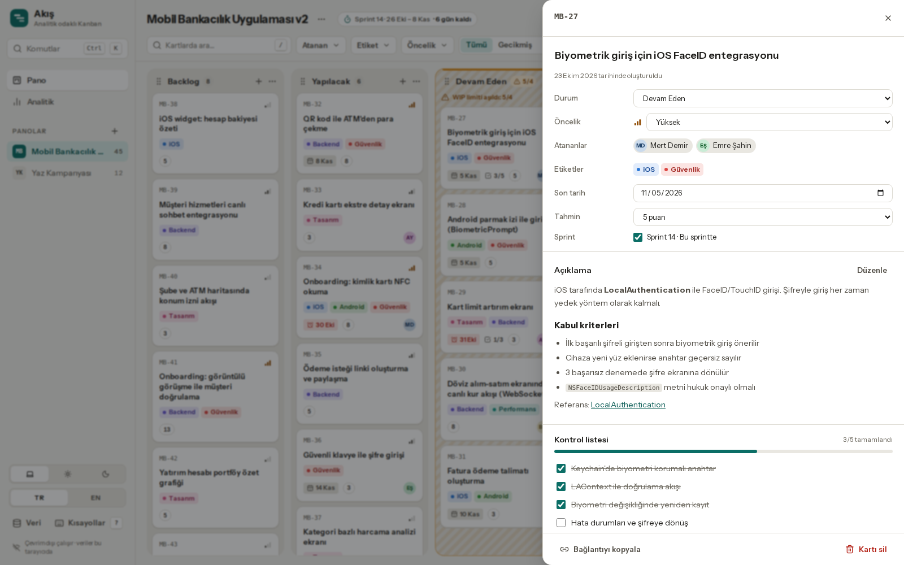
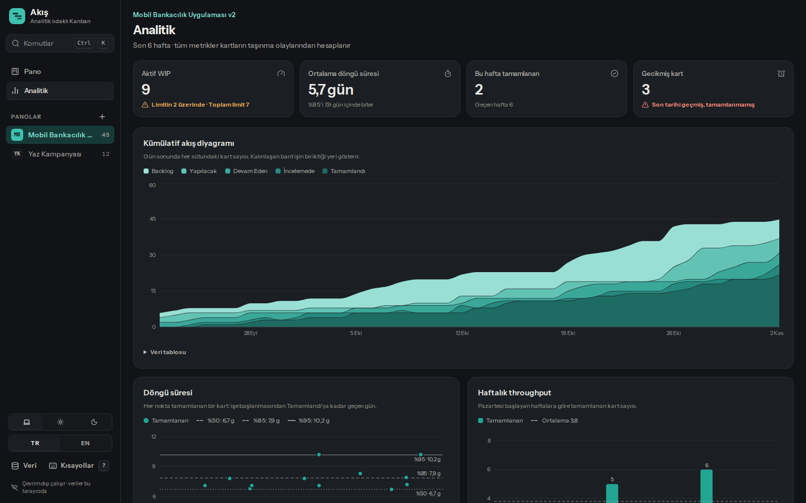
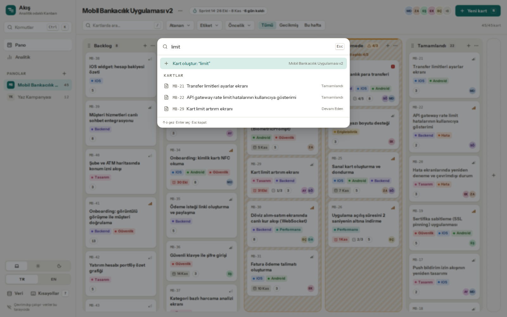
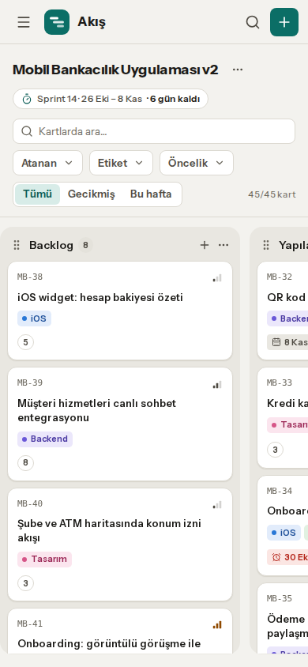

# Akış · Analitik odaklı Kanban

[](https://github.com/nurullahmencik/akis-kanban/actions/workflows/ci.yml)
[](LICENSE)

**Akış, kartların taşınma geçmişinden akış metriklerini (kümülatif akış, döngü süresi, throughput, burndown) hesaplayan, arka ucu olmayan ve çevrimdışı çalışan bir Kanban proje yönetim uygulamasıdır.**

**Canlı demo:** https://nurullahmencik.github.io/akis-kanban/



| Kart ayrıntısı | Analitik (koyu tema) |
| --- | --- |
|  |  |
| **Komut paleti** | **Mobil (390 px)** |
|  |  |

## Özellikler

**Pano**
- Birden çok pano ve kenar çubuğunda pano değiştirici; her panonun kendi kart anahtarı vardır (`MB-27`).
- Sütunlar eklenebilir, yeniden adlandırılabilir ve sürüklenerek ya da menüden sıralanabilir. Her sütunun bir türü (Backlog, Bekleyen, Aktif iş, Tamamlandı) ve isteğe bağlı WIP limiti vardır. Limit aşılınca sütun çizgili bir arka plan, üst şerit ve metinli uyarı alır.
- Kartlar fare, dokunmatik ve klavyeyle taşınır (dnd-kit). Klavyede kart Boşluk ile alınır, ok tuşlarıyla sütunlar ve sıralar arasında gezdirilir, Boşluk ile bırakılır. Ekran okuyuculara her adım Türkçe ya da İngilizce duyurulur.
- Kart yüzünde öncelik, renkli etiketler, son tarih (gecikmişse kırmızı ve farklı ikonla), kontrol listesi ilerlemesi, tahmin puanı ve baş harfli avatarlar görünür.

**Kart ayrıntısı**
- Sağdan açılan çekmecede başlık, durum, öncelik, atananlar, etiketler (yeni etiket de oluşturulabilir), son tarih, tahmin, sprint kapsamı, markdown açıklama ve kontrol listesi düzenlenir.
- Her kartın derin linki vardır (`?board=mobil-v2&card=mobil-v2-27`). Tarayıcının geri tuşu çekmeceyi kapatır.
- Aktivite akışı kimin neyi ne zaman yaptığını gösterir: oluşturma, sütunlar arası taşıma ve alan değişiklikleri.

**Verimlilik**
- Komut paleti (`Ctrl/⌘ + K`): kart oluşturma (yazdığınız metinden tek adımda), kart arama ve açma, panoya ya da analitiğe gitme, tema ve dil değiştirme, geri alma ve yineleme.
- Kısayollar: `n` yeni kart, `/` arama, `?` kısayol yardımı, `Ctrl/⌘ + Z` geri al, `Ctrl/⌘ + Shift + Z` yinele.
- **Her değişiklik** geri alınabilir: kart, sütun, pano, etiket ve kontrol listesi işlemleri dahil.
- Filtreler URL ile senkron çalışır: atanan, etiket, öncelik, son tarih (gecikmiş / bu hafta) ve metin araması. Arama büyük/küçük harf ve Türkçe karakter farkını yok sayar, yani "artirim" yazınca "artırım" bulunur.

**Analitik**
- KPI kutuları: aktif WIP (limitle karşılaştırmalı), ortalama döngü süresi ve %85 değeri, bu hafta tamamlanan (geçen haftayla karşılaştırmalı), gecikmiş kart sayısı.
- Kümülatif akış diyagramı (sütun başına yığılmış alan), yüzdelik çizgili (%50 / %85 / %95) döngü süresi saçılım grafiği, haftalık throughput ve ideal çizgili sprint burndown.
- Her grafiğin altında aynı verinin erişilebilir bir tablo görünümü vardır.

**Genel**
- Açık ve koyu tema: sistem tercihini izler, elle de değiştirilebilir. İlk boyamadan önce uygulandığı için tema yanıp sönmez.
- Arayüz varsayılan olarak Türkçedir, İngilizceye geçilebilir. Tüm metinler tip güvenli sözlükten gelir.
- JSON olarak dışa ve içe aktarım (içe aktarılan dosya doğrulanır) ile "Örnek veriyi sıfırla".
- 375 px genişlikte yatay sayfa kaydırması olmaz. Mobilde sütunlar kendi içinde, kaydırma noktalarına oturarak kayar.

## Mimari ve teknik kararlar

### Neden local-first?
Uygulamanın sunucusu yoktur: veriler tarayıcıdaki IndexedDB'de (Dexie) tutulur, uygulama statik dosyalar olarak GitHub Pages'te yayınlanır. Bunun sonuçları:
- Her etkileşim anında yanıt verir, ağ beklemesi ya da yükleme göstergesi yoktur.
- İlk yüklemeden sonra bağlantı olmadan da çalışır. Veri kullanıcının cihazından çıkmaz.
- Barındırma ücretsizdir ve bakım gerektirecek bir arka uç yoktur.
- Örnek veri ilk açılışta tarayıcıda üretilir. Ziyaretçi demoyu dilediği gibi değiştirebilir, başkasının verisini etkilemez.

### Tek kaynak: zaman damgalı olay günlüğü
Her kart için `created`, `moved` ve `updated` olayları zaman damgasıyla saklanır. Hiçbir metrik ayrıca saklanmaz; hepsi bu günlükten **saf fonksiyonlarla** türetilir (`src/lib/metrics`).

| Metrik | Hesaplama |
| --- | --- |
| Kümülatif akış (CFD) | Olaylar zaman sırasıyla yeniden oynatılır. Her günün sonunda (son gün için "şu an") her sütunda kaç kart olduğu sayılır. |
| Döngü süresi | Şu an "Tamamlandı" türündeki kartlar için ölçülür. Başlangıç, kartın ilk kez "Aktif iş" türündeki bir sütuna girdiği andır; bitiş, "Tamamlandı" sütununa **son** girişidir (yeniden açılan kartlarda saat devam eder). |
| Yüzdelikler | En yakın sıra (nearest-rank) yöntemiyle hesaplanır: "%85" değeri, kartların en az %85'inin o süre içinde bittiği en küçük değerdir. Bu yüzden bir hizmet seviyesi beklentisi (SLE) olarak okunabilir. |
| Throughput | Tamamlanma anları pazartesi başlayan takvim haftalarına göre kovalanır. |
| Sprint burndown | Sprint kapsamındaki kartların tahmin puanları toplanır. Her gün sonunda henüz "Tamamlandı"da olmayan kartların puanı kalan iştir. İdeal çizgi doğrusaldır. |

Metrikler sütun **adlarına** değil **türlerine** bakar. Bu sayede sütunlar yeniden adlandırılabilir ya da araya yeni sütun eklenebilir, hesaplar bozulmaz.

### Geri al / yinele ve kalıcılık: immer patch'leri
Store (Zustand) içindeki her değişiklik `produceWithPatches` ile yapılır. Her işlem bir patch listesi ve ters patch listesi üretir:
- **Geri al / yinele**, bu listelerin `applyPatches` ile uygulanmasından ibarettir. Ayrı bir "geri alma" kodu yazmak gerekmez ve her işlem otomatik olarak geri alınabilir.
- **Kalıcılık** aynı patch'leri kullanır: patch yollarından hangi tablolardaki hangi satırların değiştiği çıkarılır ve IndexedDB'ye yalnız o satırlar yazılır. Tüm veri kümesi yeniden yazılmaz.
- Store, kalıcılık katmanını bir arayüz üzerinden alır. Birim testleri depolamasız ya da `fake-indexeddb` ile çalışır.

### Statik export kısıtları
`output: 'export'` dinamik route segmentlerine izin vermediği için pano, kart ve filtre seçimi query parametresinde tutulur. Filtre ve kart değişiklikleri `window.history.replaceState/pushState` ile yapılır. Next.js bunları `useSearchParams` ile senkronlar, böylece yazarken router turu oluşmaz ve URL anında güncellenir.

### Sürükle-bırak
Sütun sıralama ve kart taşıma tek bir `DndContext` içinde çalışır. Çakışma algılama sürüklenen öğenin türüne göre filtrelenir: kart yalnız kartları ve boş sütunları, sütun yalnız sütunları hedefler. Klavye için özel bir koordinat hesaplayıcı yazıldı: ↑/↓ kartı kendi sütununda, ←/→ komşu sütunun en yakın kartına taşır. Kart pozisyonu indeks yerine "şu kartın önüne" olarak saklanır; bu sayede filtre açıkken yapılan taşımalar da gizli kartların sırasını bozmaz.

### Örnek veri
"Mobil Bankacılık Uygulaması v2" panosunda 45 kart ve yaklaşık 6 haftalık taşınma geçmişi, "Yaz Kampanyası" panosunda 12 pazarlama kartı vardır. Veri tohumlu bir PRNG (mulberry32) ile **deterministik** üretilir. Tarihler açılış anına göre göreli hesaplanır: döngü süreleri log-normal dağılımdan gelir ve olaylar hafta içi mesai saatlerine yerleştirilir, bu yüzden grafikler gerçek bir ekibinkine benzer. Devam Eden sütunu, uyarının görülebilmesi için WIP limitini bilerek aşar.

### Performans ve erişilebilirlik
- Recharts yalnız analitik sayfasında ve ayrı bir chunk olarak yüklenir. Her grafik ekrana yaklaştığında mount edilir. Komut paleti de ilk açılışta yüklenir.
- Diyaloglar yerel `<dialog>` + `showModal()` ile yapılır: odak tuzağı, Escape ve arka planın etkisizleşmesi tarayıcıdan gelir.
- Grafik renkleri kontrast ve renk körlüğü denetiminden geçirildi. Sütun aşamaları tek tonlu sıralı bir rampa ile gösterilir. Hiçbir bilgi yalnız renkle verilmez: gecikme ikon ve metinle, WIP aşımı metinle de belirtilir.

## Teknolojiler
Next.js 16 (App Router, statik export) · React 19 · TypeScript (strict) · Tailwind CSS v4 · dnd-kit · Zustand + immer · Dexie (IndexedDB) · cmdk · Recharts · date-fns · lucide-react · Vitest · Playwright

## Klasör yapısı

```
akis-kanban/
├─ src/
│  ├─ app/                    # App Router: layout, pano (/), analitik (/analytics), 404
│  ├─ components/
│  │  ├─ board/               # pano, sütun, kart, çekmece, filtreler, DnD klavye koordinatları
│  │  ├─ analytics/           # KPI kutuları ve lazy yüklenen Recharts grafikleri
│  │  ├─ command/             # cmdk komut paleti
│  │  ├─ shell/               # uygulama iskeleti, kenar çubuğu, kısayollar, diyaloglar
│  │  └─ ui/                  # dialog, popover, avatar, markdown, toast …
│  └─ lib/
│     ├─ store/               # Zustand store, saf işlemler (operations), UI store
│     ├─ metrics/             # CFD, döngü süresi, throughput, burndown, KPI (+ testler)
│     ├─ db/                  # Dexie kalıcılık adaptörü (+ testler)
│     ├─ seed/                # deterministik örnek veri ve PRNG (+ testler)
│     ├─ i18n/                # TR/EN sözlükleri
│     └─ …                    # filtreler, tarih yardımcıları, tercihler, yedekleme
├─ e2e/                       # Playwright testleri ve ekran görüntüsü senaryosu
├─ scripts/serve-out.mjs      # out/ klasörünü /akis-kanban altında servis eden küçük sunucu
├─ docs/screenshots/          # README görselleri (Playwright ile üretildi)
└─ .github/workflows/         # ci.yml (lint → test → build → e2e), deploy.yml (GitHub Pages)
```

## Çalıştırma

Gereksinim: Node.js 22+

```bash
npm ci
npm run dev          # http://localhost:5302/akis-kanban/
```

Üretim derlemesi ve önizleme:

```bash
npm run build        # statik export -> out/
npm run preview      # http://localhost:5302/akis-kanban/ (gzip'li, GitHub Pages'e benzer)
```

## Test ve kalite

```bash
npm run lint         # ESLint, 0 uyarı sınırıyla
npm run typecheck    # tsc --noEmit (strict, noUncheckedIndexedAccess)
npm test             # Vitest: metrikler, store işlemleri, geri al/yinele, örnek veri, Dexie
npm run build && npm run test:e2e   # Playwright, üretim derlemesine karşı
npm run screenshots  # docs/screenshots altındaki görselleri yeniden üretir
```

- **Vitest:** 36 test. Kapsam: CFD kovaları, döngü süresi ve yüzdelikler, throughput, burndown, KPI, store işlemleri, geri al/yinele, kalıcılık bağlantısı, örnek verinin tutarlılığı, IndexedDB'ye gidip dönüş.
- **Playwright:** 12 senaryo. Kapsam: kartı fareyle, dokunmatik uzun basmayla ve klavyeyle taşıma (ekran okuyucu duyurusu dahil), komut paletinden kart oluşturma, palette arama, tema ve dil değiştirme, analitik grafiklerinin render olması, yenileme sonrası kalıcılık ve geri al/yinele, URL filtreleri, derin link ve geri tuşu, WIP uyarısı, 375 px'te yatay kaydırma olmaması.
- **Lighthouse (mobil, üretim derlemesi, 3 çalıştırmanın medyanı):**

  | Sayfa | Performance | Accessibility | Best Practices | SEO |
  | --- | --- | --- | --- | --- |
  | Pano | 91 | 100 | 100 | 100 |
  | Analitik | 89 | 100 | 100 | 100 |

## Bilinen sınırlamalar
- Veri tarayıcıya özeldir. Cihazlar ve sekmeler arasında senkronizasyon yoktur (iki sekmede aynı anda düzenleme yapılırsa son yazan kazanır).
- Geri alma geçmişi bellekte tutulur, sayfa yenilenince sıfırlanır. Geri alınan durumun kendisi ise kalıcıdır.
- Mobilde sürükle-bırak kısa bir basılı tutmayla başlar (sayfa kaydırmayla çakışmaması için).

## Lisans
[MIT](LICENSE) © Nurullah Mencik

---

## English summary

**Akış** ("flow" in Turkish) is a local-first, analytics-first Kanban app built with Next.js 16 (static export), React 19 and strict TypeScript. It has no backend: data lives in IndexedDB via Dexie and the app works offline. Live demo: https://nurullahmencik.github.io/akis-kanban/

- **Board:** multiple boards; columns can be added, renamed and reordered, and each has a WIP limit with a visible warning when exceeded. Cards move with mouse, touch or keyboard (dnd-kit, with announcements localized for screen readers). A card drawer has a deep link, a markdown description, a checklist, labels, assignees, a due date, an estimate and an activity feed.
- **Productivity:** a cmdk command palette, keyboard shortcuts (`n`, `/`, `?`), undo/redo for every change, and filters synced to the URL.
- **Analytics:** a cumulative flow diagram, a cycle time scatter plot with 50/85/95th percentile lines, weekly throughput, a sprint burndown and KPI tiles. Everything is derived from timestamped card move events by pure, unit-tested functions.
- **How it works:** every mutation goes through immer's `produceWithPatches`. The same patches power undo/redo and incremental IndexedDB writes (only the touched rows are written).
- **Quality:** ESLint with 0 warnings, strict typecheck, 36 Vitest tests and 12 Playwright tests against the production build. Lighthouse mobile: Performance 91 / 89 (board / analytics), and 100 for Accessibility, Best Practices and SEO.
- Turkish UI by default with an English toggle, plus light, dark and system themes. Licensed under MIT.
